# MSI-MAG-B560M-i5-11400
MSI-MAG-B560M-MORTAR-WIFI-i5-11400-BIG-SUR

> PS: I’ve referenced a lot of material from experts. Thank you all, I’m just a messenger of nature’s work.

### Updates

- 2021.1.24 ---- OpenCore-0.7.7

Fixed a bug where Bluetooth couldn’t be enabled after customizing USB.

- 2021.1.22 ---- OpenCore-0.7.7

macOS Big Sur 11.6 → macOS Big Sur 11.6.2 Everything is working fine.

> PS: Using `OCAT` and adjusting the recommended `quirks` resolved the `OCB:StartImage failed - Aborted` boot error.

### Current: OpenCore-0.7.7

Installed `macOS Big Sur 11.6`

Three codes obtained via `Hackintool`.

### Hardware Configuration

| Configuration   | Model   |
| ---- | ---- |
| CPU  | I5-11400 |
| Motherboard  | MSI B560M Mortar WiFi |
| Memory  | Samsung 2400 8G |
| Graphics Card  | I5-11400 integrated graphics UHD730 + NVIDIA GeForce GT 710 |
| Network Card  | Onboard AX210 |
| Sound Card  | Onboard Realtek ALC897 |
| Hard Drive  | Samsung 970 EVO Plus 1TB (latest firmware version 2B2QEXM7) |
| Model  | iMac20,1 |

According to online reports, the integrated graphics of the `B560M` motherboard don’t support output, so a driverless dedicated graphics card is required. Otherwise, you’ll encounter a black screen after installation—I’ve experienced this issue myself.

### Functionality Tests

- [x] Onboard sound card
- [x] Onboard network card
- [x] Sleep and wake functionality
- [x] CPU frequency scaling
- [x] All USB ports
- [x] AirDrop and Continuity
- [x] Onboard Bluetooth

[❌] Integrated graphics hardware acceleration

### BIOS Settings

- USB device wake from S3/S4/S5: Enabled
- PS/2 mouse wake from S3/S4/S5: Enabled
- USB keyboard wake from S3/S4/S5: Any key
- Integrated graphics multi-monitor support: Enabled (otherwise integrated graphics hardware decoding will fail; ignore if using only integrated graphics)
- OC -> CPU Features -> Intel Virtualization Technology: Enabled
- OC -> CPU Features -> Intel VT-D Technology: Disabled
- OC -> CPU Features -> CFG Lock: Disabled

### BIOS Version

Current BIOS version: 1715.60.5.0.0

### System Time Correction

- Run as administrator in Windows

```
Reg add HKLM\SYSTEM\CurrentControlSet\Control\TimeZoneInformation /v RealTimeIsUniversal /t REG_DWORD /d 1
```

### Set Default Boot Item

- In `config.plist`, enable the “Poll Apple Hot Key” option to simulate Apple shortcuts. In the boot selection screen, select the desired boot item, then press `Ctrl` + `Enter` to start the system.

- Another method: Go to `Settings` -> `Startup Disk` to select the default boot item, make changes, and restart.

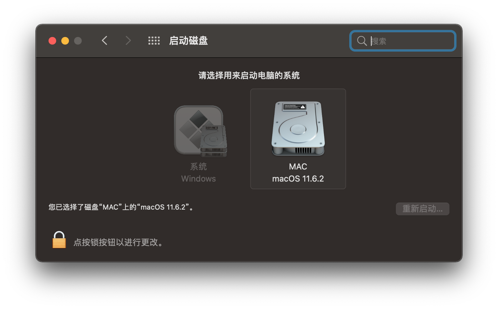

### Areas Still Needing Work

- Integrated graphics are not functional.
- - -

# About This Machine

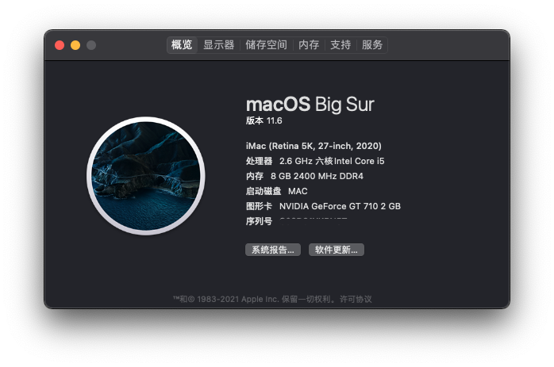
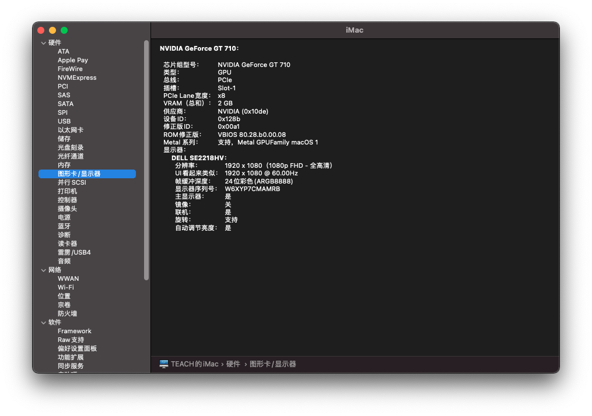
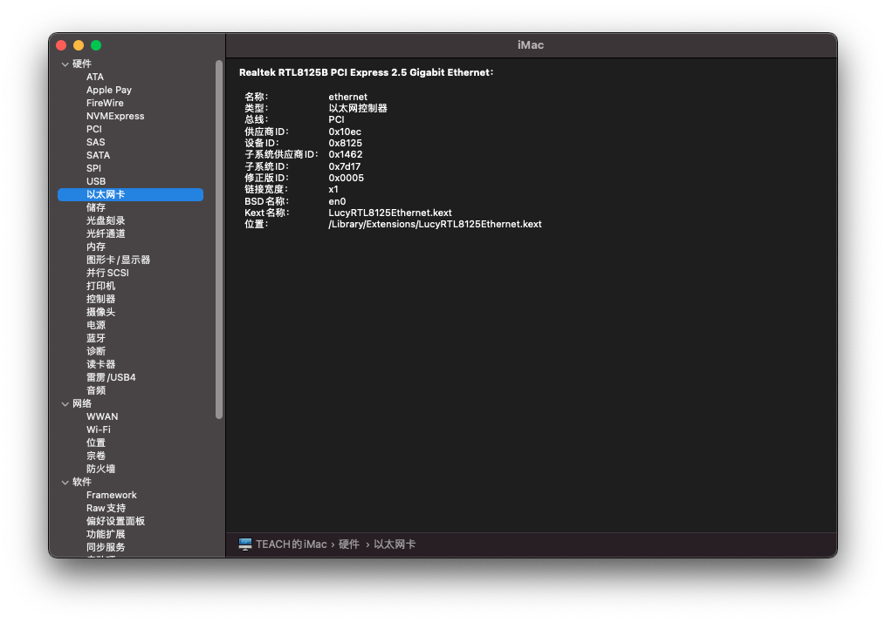
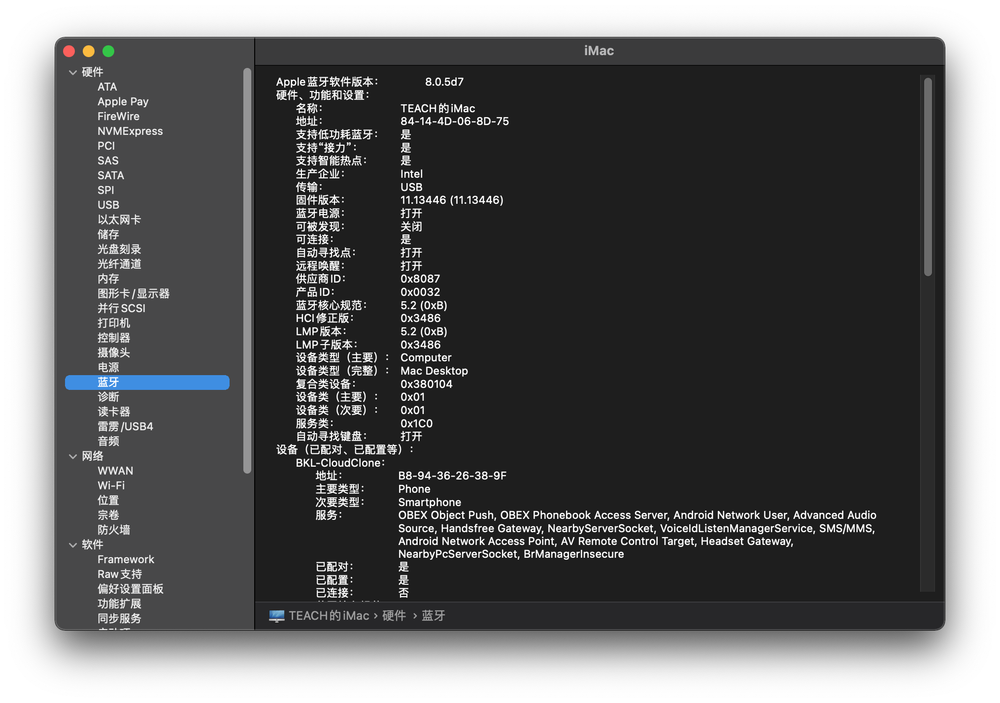
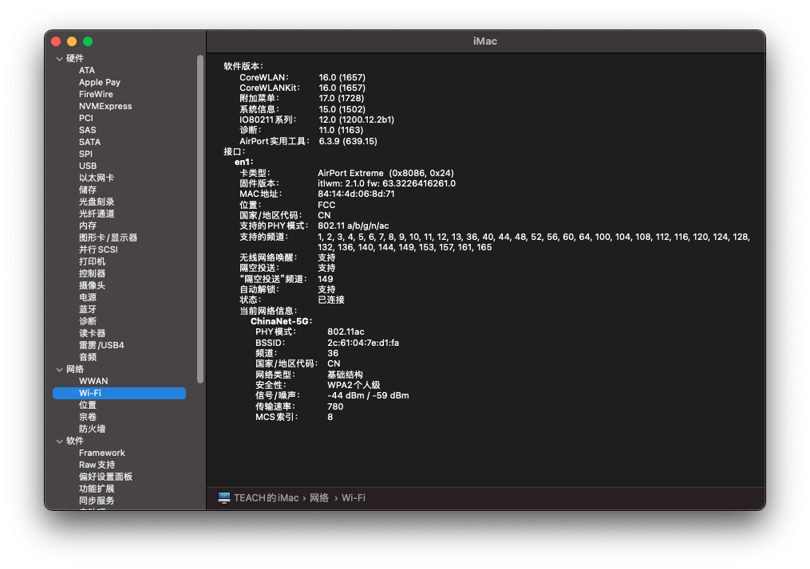
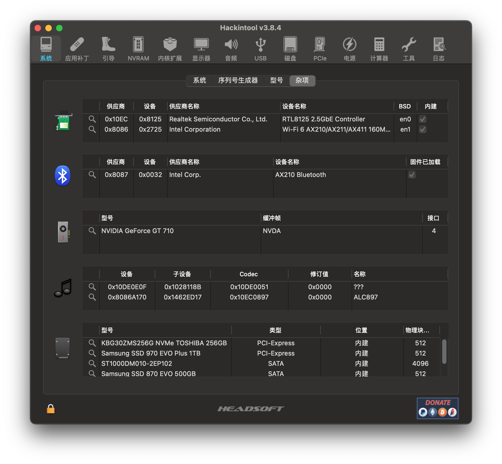
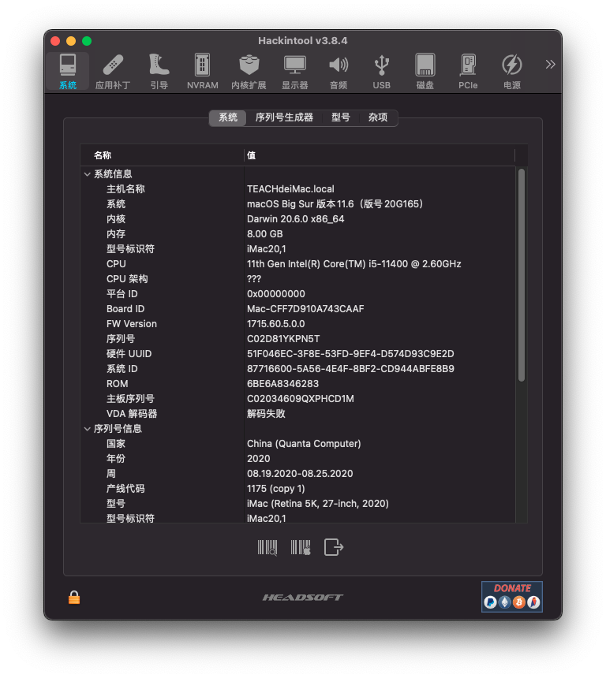
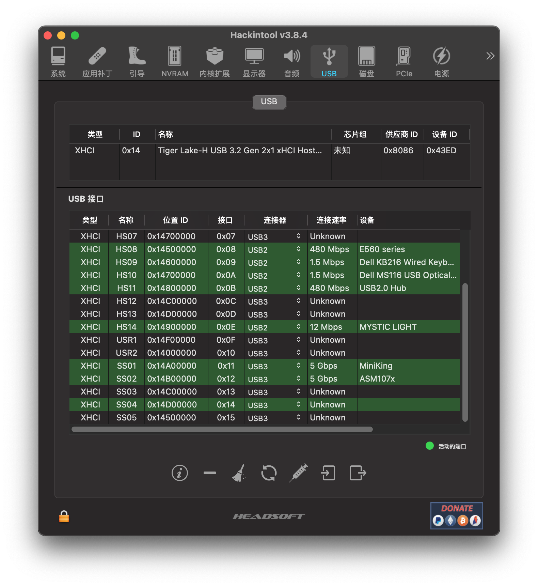

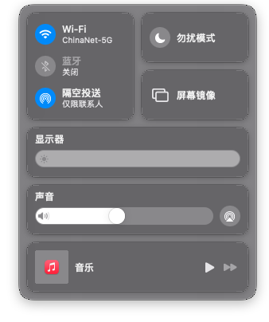
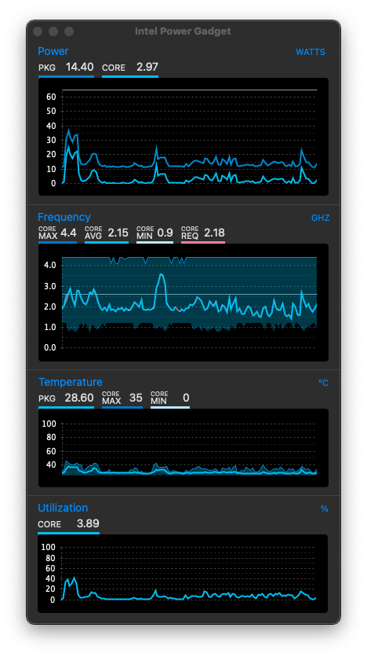
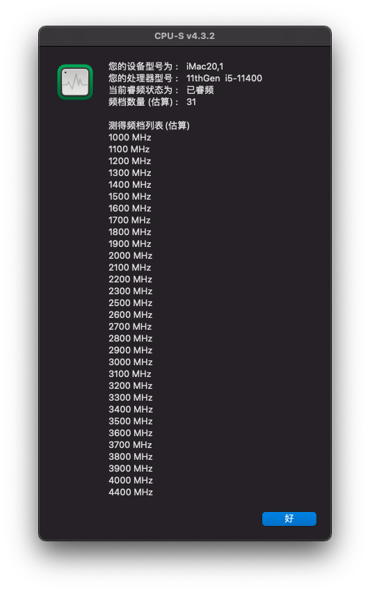
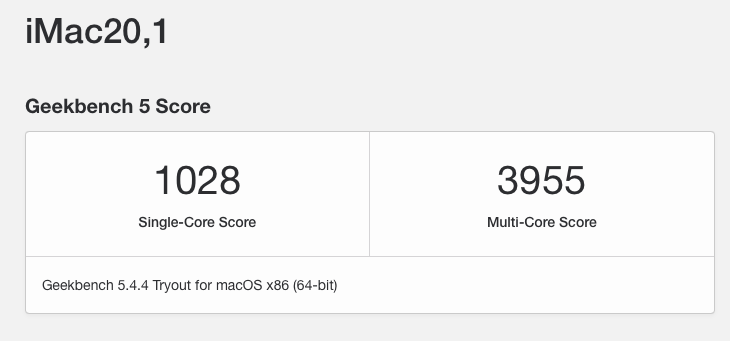

---

Other areas to be improved later.
